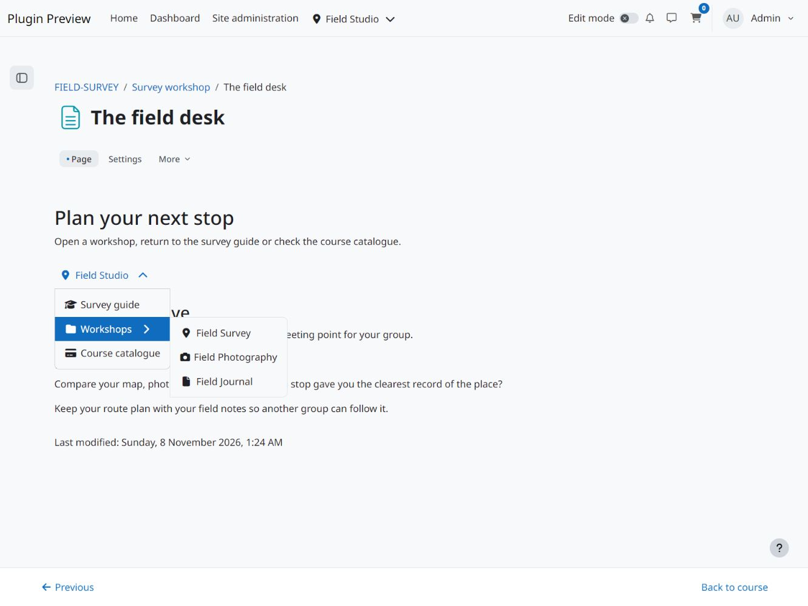

<p align="center">
  
</p>

# Menu Builder Shortcode Filter

Insert a saved Menu Builder menu into Moodle content with a shortcode. Use it to add a set of navigation links within a Page activity or another text area where Moodle runs filters. Edit the menu in Menu Builder to update every place that uses its shortcode.

## Screenshots

<details>
<summary>View screenshots</summary>



</details>

## Requirements and installation

- Moodle 4.5 through 5.3.
- A saved menu in [Menu Builder](https://github.com/108design/moodle-local_menubuilder-le).

Download the signed installation ZIP from the [latest release](https://github.com/108design/moodle-filter_frontpage_menu/releases/latest). Upload it under **Site administration > Plugins > Install plugins**. For a manual installation, place the `frontpage_menu` directory in `filter/` and complete the upgrade under **Site administration > Notifications**. [Moodle installation guide](https://docs.moodle.org/503/en/Installing_plugins)

## Enable the filter and insert a menu

1. Open **Site administration > Plugins > Filters > Manage filters**. Set **Menu Builder shortcode** to **On** for the site, or choose **Off but available** and enable it in the course or activity that will use it.
2. Copy the shortcode shown for your saved menu in Menu Builder.
3. Paste it into the Moodle text where you want the menu to appear. Save and open the activity to check the result.

For a menu with the key `course-links`, the shortcode is:

```text
[[frontpage-menu:course-links]]
```

The key stays the same when you rename or edit the menu. A duplicated menu has its own key. Menu Builder controls which entries each viewer sees, and Moodle checks access when the viewer follows a link. [Moodle filter settings](https://docs.moodle.org/503/en/Managing_filters)

## Check the rendered menu

If Moodle displays the shortcode as text, check that the filter is enabled in that context and that the text field runs Moodle filters. If the menu area is empty, check that the menu key still exists and the viewer can see at least one entry. Review embedded shortcodes before deleting a shared menu, as Menu Builder’s usage list cannot search every Moodle text field.

To place a menu in a side column or another block region, use the [Menu Builder Block](https://github.com/108design/moodle-block_frontpage_menu).

## Support

[Report an issue](https://github.com/108design/moodle-filter_frontpage_menu/issues) with your Moodle version, plugin version, the type of content where you used the shortcode and steps to reproduce the problem.

## License

This release is available free of charge under the 108design Software License.

See [LICENSE.md](LICENSE.md) for the full terms.
